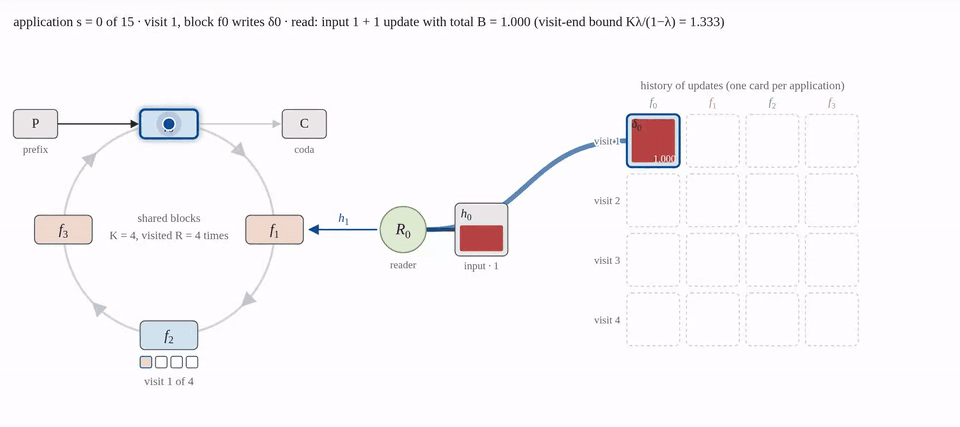
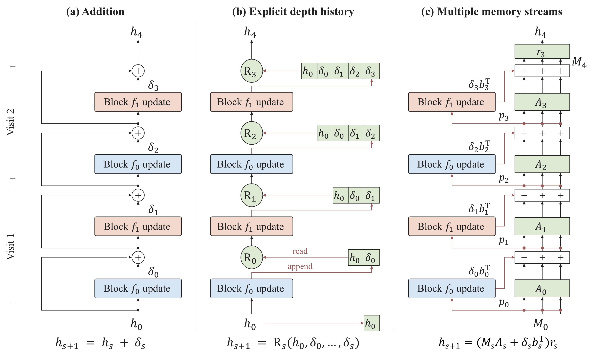
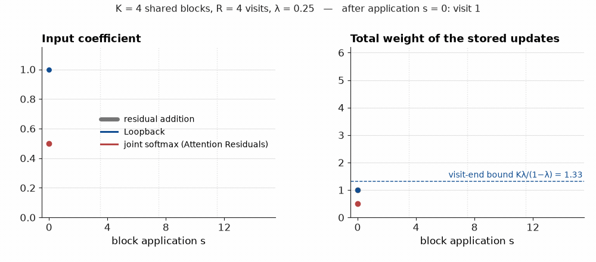
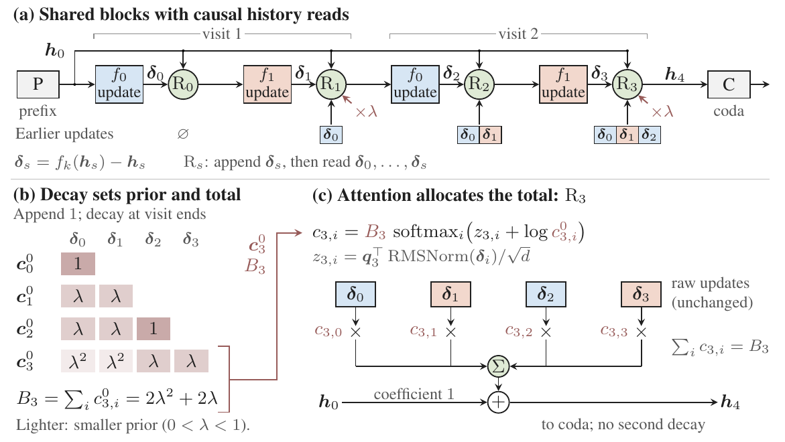
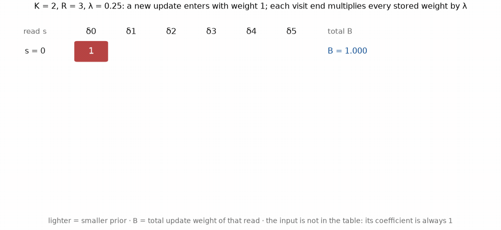
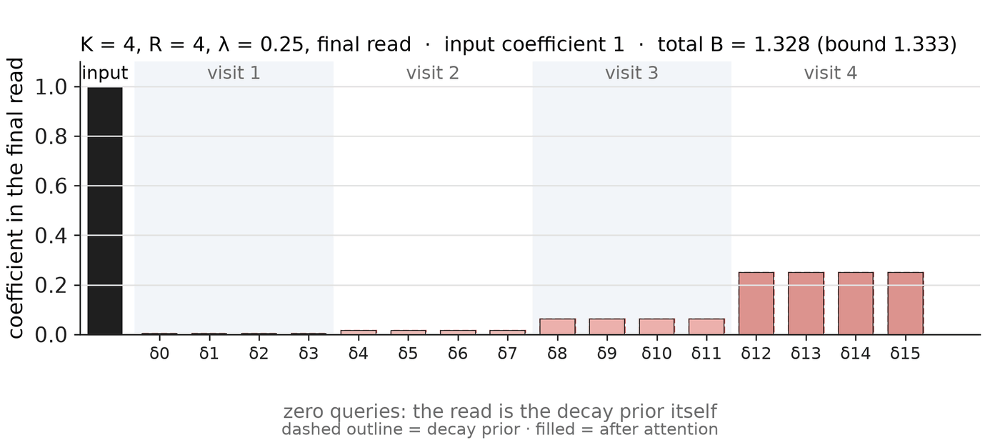
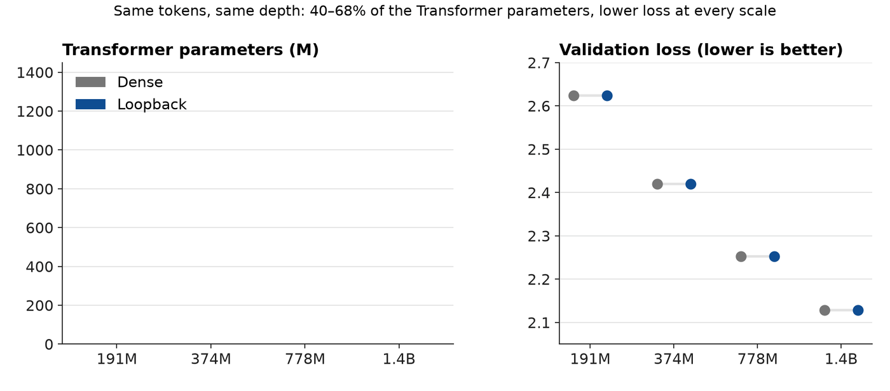
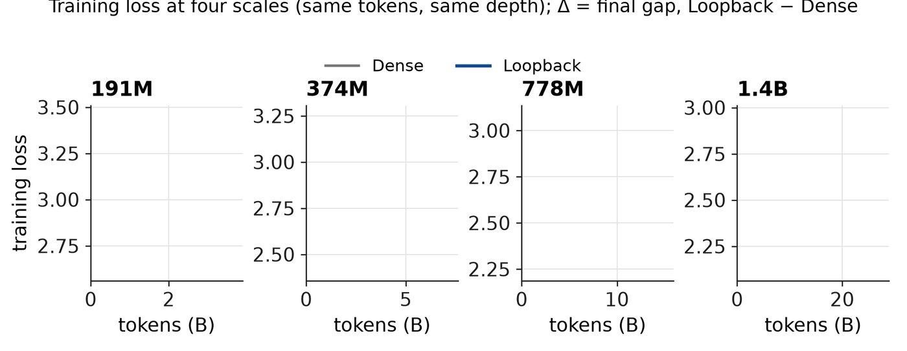
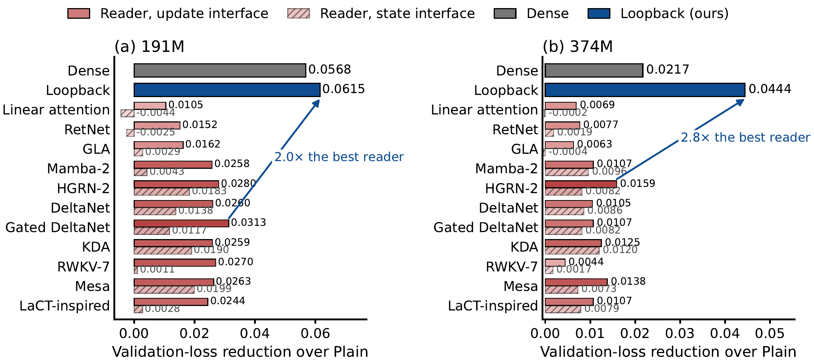

# Loopback Transformer: Towards a Unified View of Residual Looped Transformers

**Authors**: Xuan Ouyang, Zefan Cai, Chenlong Zhang, Cheng Luo, Ke Wan, Junjie Hu

**Affiliations**: University of Wisconsin–Madison, UC Santa Barbara, Caltech, Microsoft

**Paper**: arXiv (link coming) · **Project page and interactive demo**: [yancyou.github.io/Loopback_page](https://yancyou.github.io/Loopback_page/) · **Code**: coming soon

> 📢 **TL;DR.** A looped Transformer reuses a few shared blocks many times. We show that *what the loop remembers between visits* matters as much as the blocks themselves, and we give the memory a simple rule: store each block's **update** (not its output), keep the loop's **input on its own path**, let a geometric **decay** set how much history is used, and let **attention** decide where that weight goes. The result, the **Loopback Transformer**, reaches lower validation loss and higher zero-shot accuracy than dense Transformers trained on the same tokens at the same depth, with **40%, 58%, 67% and 68%** of their Transformer parameters at **191M, 374M, 778M and 1.4B**.
> 
> Along the way we show that residual addition, Attention Residuals, Hyper-Connections, mHC, Hyperloop and recurrent-depth readers (Mamba-2, DeltaNet, RWKV-7, …) are all instances of one write–carry–read interface, which makes their differences, and Loopback's design, easy to state.

**Takeaways**

> 🔥 - **Store updates, not outputs.** A block's full output contains its input, so weighting that output also re-weights the history the input carries. Storing the update $\boldsymbol{\delta}_s=f_k(\boldsymbol h_s)-\boldsymbol h_s$ on its own gives every visit a coefficient of its own.
> - **Keep the input on its own path.** A joint softmax over the input and the stored updates makes them compete for one unit of weight, so the input fades as depth grows; plain addition keeps the input fixed but lets the total update weight grow with every block application. Loopback fixes the input coefficient at 1 and bounds the total.
> - **Decay sets the total, attention allocates it.** A geometric factor $\lambda$ at each visit end gives a recency prior whose visit-end total is at most $K\lambda/(1-\lambda)$; a softmax over the stored updates redistributes that total. Decay alone recovers most of the gain over the plain loop (2.6802 → 2.6220 at 191M); learned allocation adds the rest (2.6187).
> - **Reading updates beats reading states.** Eleven linear-attention and recurrent readers (Gated DeltaNet, Mamba-2, RWKV-7, …) all do better when fed the stored updates than when fed loop states, and all of them stay behind Loopback.
> - **It costs little.** About +0.08% forward FLOPs, a fused Triton kernel that streams the stored updates once per read, and at 1.4B a model whose weights take 1.87 GiB instead of 2.64 GiB in bf16.



*The loop, one application at a time. The hidden state circles the shared blocks (blue and peach); every application appends its update to the history on the right, and the reader forms the next state from the input (fixed coefficient 1) and the stored updates. At each visit end every stored weight is multiplied by λ; attention then reallocates the total. The interactive version with sliders for K, R, λ and the attention query is on the project page.*

---

# 🔁 Why a looped model needs a memory rule

Depth is one of the cheapest things to add to a Transformer and one of the most expensive to pay for. Every extra block costs parameters, and parameters cost memory, bandwidth and money at inference time. Looped Transformers, from the Universal Transformer and ALBERT to the recent latent-reasoning models, take a different route: run a prefix of ordinary blocks, then **visit a shared stack of $K$ blocks $R$ times**, then run a coda. We write such a topology as $[P \to K \times R \to C]$. The 191M model below is $[2 \to 4 \times 4 \to 2]$: 20 block applications from 8 distinct blocks. The model gets to refine one hidden state over and over, and the extra visits are free in parameters.

Here is the catch. Each visit applies the *same* transformation to a *different* hidden state and therefore produces a different update. Parameter sharing decides which transformation is reused; it says nothing about **how the results of repeated visits should be stored, carried forward and used**. That question is usually answered by default, with the plain residual connection, and the default is not a good answer: at 191M the plain loop is 0.057 of validation loss behind a dense model of the same depth, and at 374M it is 0.022 behind. Something in how the loop accumulates its own work is wasting the computation.

### Residual connections are memory

The useful way to see this is the *depth-memory* view of residual connections. Every layer **writes** new computation into the residual stream, the stream **carries** it forward, and later layers **read** it to form their input. Written as one interface, a memory $\boldsymbol M_s$ with a few columns is updated and read at every application:

$$
\boldsymbol M_{s+1}=\boldsymbol M_s\boldsymbol W_s+\boldsymbol v_s\boldsymbol b_s^{\top},\qquad \boldsymbol h_{s+1}=\boldsymbol M_{s+1}\boldsymbol r_s .
$$

$\boldsymbol v_s$ is the value the $s$-th application writes, $\boldsymbol b_s$ says where it goes, $\boldsymbol W_s$ carries (or mixes, or decays) the old memory, and $\boldsymbol r_s$ reads the memory into the next hidden state. The familiar residual rules are just settings of these four controls:

| Rule | Writes $\boldsymbol v_s$ | Carry $\boldsymbol W_s$ | Read $\boldsymbol r_s$ |
|---|---|---|---|
| Residual addition | the update | 1 | 1 (sum everything) |
| Attention Residuals | layer outputs, kept as an explicit history | identity (append a column) | one softmax over input and history |
| Hyper-Connections / mHC / iHC | block outputs into several streams | learned (mHC: doubly-stochastic, iHC: identity) | learned mixing of the streams |
| Hyperloop | block outputs | learned diagonal carry between loop visits | learned |
| Recurrent readers (Mamba-2, DeltaNet, RWKV-7, …) | keys and values of a fixed-size state | gates, decay, delta-rule corrections | a query |
| **Loopback (ours)** | **the update, with the input kept outside the memory** | **geometric decay at visit ends** | **attention over the stored updates** |



*Figure 1. Three ways to carry depth as memory: (a) residual addition, (b) an explicit history of updates read by a learned reader, (c) multiple memory streams. All three fit the interface above: write a value, carry the memory forward, read it to form the next hidden state.*

> 💡 **Why this view is useful.** Unrolling the interface gives every earlier update an explicit coefficient in the current hidden state, $\boldsymbol h_{s+1}=a_{s+1}\boldsymbol h_0+\sum_{i\le s}c_{s,i}\boldsymbol{\delta}_i$. Three quantities then describe any rule: the **input strength** $a$, the **total update weight** $B=\sum_i c_{s,i}$, and the **allocation** $\pi_i=c_{s,i}/B$ across visits. Once you look at residual rules this way, the problems with the usual choices are visible by inspection, and so is the fix.

# ⚖️ Two couplings hidden in the usual choices

### 1. Storing a full output also stores its input

A block's output is $\boldsymbol y_s=\boldsymbol h_s+\boldsymbol{\delta}_s$: the new update plus the input the block received. If the memory stores $\boldsymbol y_s$ and a reader later assigns it a weight $c$, that weight lands on $\boldsymbol h_s$ too, which already contains the whole history up to step $s$. Earlier information gets re-weighted as a side effect of weighting later outputs, and a reader that wants to down-weight one noisy visit cannot do so without also touching everything that visit was built on. Storing $\boldsymbol{\delta}_s$ alone lets a reader address each visit's contribution directly. (This is a parameterization choice rather than an expressivity claim: an unrestricted carry matrix could undo the coupling, but nothing in the usual rules does.)

### 2. One softmax couples the input to the updates

With a joint softmax over the input and all stored updates, the coefficients sum to one, so after $s$ applications the input is left with a weight of about $1/(s+2)$ while the updates share the rest. Plain addition has the opposite problem: the input keeps coefficient one, but every update also gets coefficient one, so the total update weight is $s+1$ and keeps growing with depth.

$$
\begin{aligned} \text{addition:}&\quad \boldsymbol h_{s+1}=\boldsymbol h_0+\sum_{i\le s}\boldsymbol{\delta}_i \\[2pt] \text{joint softmax:}&\quad \boldsymbol h_{s+1}=c_{\mathrm{in}}\,\boldsymbol h_0+\sum_{i\le s}c_i\,\boldsymbol{\delta}_i,\qquad c_{\mathrm{in}}+\sum_{i\le s} c_i=1 \end{aligned}
$$



*Figure 2. The three rules as the loop runs (K = 4, R = 4, λ = 1/4). Left: the coefficient of the input. Right: the total weight of the stored updates. Under addition the total grows without bound; under a joint softmax the input fades; under Loopback the input stays at 1 and the visit-end total (dots) approaches the bound Kλ/(1−λ) while the within-visit reads (thin line) stay bounded too.*

Neither rule gives independent control over the three quantities that matter in a loop: **how strongly the input enters**, **how much total weight the updates get**, and **how that weight is allocated** across visits. In a 20-deep loop the differences are not academic: the plain loop hands its coda a sum of 16 unit-weight updates, and an attention-residual loop hands it an input diluted to a sixteenth. Loopback is built to control each quantity separately.

# 🧭 The Loopback recipe



*Figure 3. Loopback on a two-visit loop. (a) Each shared-block application appends its update δ and reads the history. (b) Visit-end decay sets the prior and the total weight. (c) Attention reallocates that total across the raw updates; the input enters with coefficient one and is never decayed.*

### Step 1. Store the update, keep the input on its own path

Every application of a shared block writes only its update $\boldsymbol{\delta}_s=f_k(\boldsymbol h_s)-\boldsymbol h_s$ into the history. The shared stack's input $\boldsymbol h_0$ never enters that history: it is added back directly, with coefficient one, in every read. The shared blocks themselves (attention, MLP and their internal residuals) are untouched, so Loopback is a change to the residual rule *around* the loop, not to the blocks inside it.

### Step 2. Let decay set the prior and the total

At the end of each visit, every stored weight is multiplied by a fixed $\lambda$ (we use $\lambda=1/4$). Counting the visit ends between a write at step $i$ and a read at step $s$ gives a prior $c^0_{s,i}$ and its total $B_s$:

$$
c^0_{s,i}=\lambda^{\lfloor (s+1)/K\rfloor-\lfloor i/K\rfloor},\qquad B_s=\sum_{i=0}^{s}c^0_{s,i}.
$$



*Figure 4. The decay prior, row by row, for K = 2 shared blocks and R = 3 visits (λ = 1/4). Each read s sees the updates written so far; a new update enters with weight 1, and a visit end multiplies every stored weight by λ. The total B of each read is on the right. Darker cells carry more weight, so the prior favors the current visit without ever forgetting the earlier ones.*

The prior favors recent visits, and the total handed to the coda is $B_{KR-1}=K\sum_{j=1}^{R}\lambda^j\le K\lambda/(1-\lambda)$ instead of $KR$: the update weight is bounded no matter how many visits the loop runs. With zero attention queries this is the whole rule, and it has a closed form: the loop output is $\boldsymbol h_0+\lambda\,(F(\boldsymbol h)-\boldsymbol h_0)$ with $F$ the shared stack, which is why we call the decay-only variant the *anchored* loop. It is a one-line change to a plain looped Transformer and, as the ablations below show, it already recovers most of the gain.

### Step 3. Let attention allocate the total

A destination query scores the normalized stored updates and redistributes the decay-set total across them; the softmax is over updates only, so the input coefficient stays at one and the total $B_s$ is conserved:

$$
\begin{aligned} \boldsymbol k_i&=\frac{\boldsymbol{\delta}_i}{\sqrt{d^{-1}\|\boldsymbol{\delta}_i\|^2+\varepsilon}},\qquad z_{s,i}=\boldsymbol q_s^{\top}\boldsymbol k_i/\sqrt d, \\[2pt] c_{s,i}&=B_s\,\operatorname{softmax}_i\bigl(z_{s,i}+\log c^0_{s,i}\bigr),\qquad \boldsymbol h_{s+1}=\boldsymbol h_0+\sum_{i=0}^{s}c_{s,i}\,\boldsymbol{\delta}_i . \end{aligned}
$$



*Figure 5. Attention reallocates, decay decides the budget. The final read of a K = 4, R = 4 loop: the dashed outlines are the decay prior, the filled bars the coefficients after attention. As the query turns toward visit 2 and then visit 4, weight moves between visits while the total B = 1.328 and the input coefficient (black bar) stay exactly where decay put them.*

Two sanity checks fall out of the formula. Zero queries recover the decay-only loop exactly; $\lambda=1$ with zero queries recovers ordinary addition. Everything Loopback adds is in the read, so a fused Triton kernel that streams the stored updates once per read is all the extra machinery it needs.

> 🧩 **A worked example.** Take $K=2$, $R=3$, $\lambda=1/4$ as in Figure 4. After the first visit the two updates each carry weight $\lambda=0.25$, so $B=0.5$. The second visit writes two new updates at weight 1 each, and at its end all four are decayed: the old pair to $\lambda^2=0.0625$, the new pair to $0.25$, $B=0.625$. After the third visit $B=0.656$, close to the bound $K\lambda/(1-\lambda)=0.667$. A plain loop would have $B=6$ at the same point and an attention-residual loop would have an input coefficient of $1/7$. Attention can then move the 0.656 around, for instance putting most of it on the visit whose updates the current token finds useful, but it cannot make it 6 and it cannot touch the input.

---

# 📈 Results

All comparisons share the training-token budget and the computational depth (number of block applications) within a scale; parameter counts are Transformer-only, excluding embeddings and the vocabulary head, with shared weights counted once. Models are trained from scratch on ClimbMix with a warmup–stable–decay schedule at 20 tokens per parameter of the dense control, so the budgets are 3.82B, 7.47B, 15.60B and 28.31B tokens at the four scales. Looped arms at a scale share the same topology, data order and learning rate; the dense control uses its own best learning rate. Validation loss is measured with the same document packing as training.

### Dense-model quality from a fraction of the parameters



*Figure 6. Four scales, same tokens, same depth. Left: Transformer parameters of the dense control and of Loopback. Right: validation loss. Loopback keeps 40%, 58%, 67% and 68% of the parameters and ends below the dense control at every scale.*

| Scale | Topology | Transformer params (Dense → Loopback) | ClimbMix loss (Dense → Loopback) | 7-task mean (Dense → Loopback) |
|---|---|---|---|---|
| 191M | [2 → 4 × 4 → 2] | 141.6M → 56.7M (40%) | 2.6234 → **2.6187** | 39.81 → **40.16** |
| 374M | [2 → 10 × 2 → 2] | 308.3M → 179.9M (58%) | 2.4198 → **2.3971** | 43.28 → **44.27** |
| 778M | [2 → 8 × 2 → 6] | 679.6M → 453.1M (67%) | 2.2521 → **2.2334** | 47.83 → **48.73** |
| 1.4B | [3 → 8 × 2 → 6] | 1,284.6M → 873.6M (68%) | 2.1283 → **2.1073** | 52.11 → **52.98** |

The seven tasks are PIQA, HellaSwag, WinoGrande, OpenBookQA, ARC-Easy, ARC-Challenge and LAMBADA (zero-shot, lm-evaluation-harness). On the thirteen-task suite the 778M and 1.4B models also lead, 43.39 vs 42.71 and 46.33 vs 45.69, and their WikiText perplexity is lower (25.03 vs 25.80; 20.29 vs 21.09). Individual tasks are mixed, as they always are at these scales, so we read the means and the loss together rather than any single task.



*Figure 7. Training loss of Loopback and the dense control at each scale. The curves separate early and the gap (Δ, Loopback − Dense) is stable through the decay phase of the schedule; the largest gap, 0.0235 at 374M, is where Loopback keeps the smallest share of parameters among the two larger-margin scales.*

### Against eight other residual rules

At 191M and 374M we trained every rule on the same looped topology, with the same data order and the same learning rate for all looped arms. Validation loss and the seven-task mean:

| Rule | 191M loss | 191M mean | 374M loss | 374M mean |
|---|---|---|---|---|
| Dense (full parameters) | 2.6234 | 39.81 | 2.4198 | 43.28 |
| Plain loop (addition) | 2.6802 | 39.03 | 2.4415 | 43.37 |
| mHC | 2.6250 | 39.83 | 2.4062 | 44.17 |
| HC | 2.6449 | 39.20 | 2.4249 | 43.72 |
| iHC | 2.6564 | 39.67 | 2.4217 | 43.35 |
| Hyperloop | 2.6489 | 39.12 | 2.4179 | 44.07 |
| MHAR | 2.6564 | 39.04 | 2.4223 | 43.64 |
| Attention Residuals | 2.6647 | 39.73 | 2.4601 | 42.89 |
| **Loopback** | **2.6187** | **40.16** | **2.3971** | **44.27** |

The plain loop pays 0.057 and 0.022 of loss for sharing its blocks. Loopback gives all of that back and then some; the strongest alternative, mHC, lands 0.006 and 0.009 behind it in loss. These are complete-design comparisons: the stream methods place their mixing at visit boundaries, Attention Residuals reads sublayer outputs, and our multi-head attention-residual adaptation (MHAR) reads loop states, so each row is a method as its authors would run it on this topology, not a one-knob ablation. The full thirteen-task tables, per-task numbers and the learning-rate protocol are in the paper.

---

# 🔬 What makes it work

### Decay does most of the work, attention finishes it

Switching the two mechanisms on and off separately gives a clean 2 × 2. Fixed allocation means zero queries; decay off means $\lambda=1$.

| Decay \ Allocation | Fixed (191M) | Learned (191M) | Fixed (374M) | Learned (374M) |
|---|---|---|---|---|
| Off (λ = 1) | 2.6802 | 2.6621 | 2.4415 | 2.4308 |
| On (λ = 1/4) | 2.6220 | **2.6187** | 2.3999 | **2.3971** |

Decay alone moves the plain loop from 2.6802 to 2.6220 at 191M and from 2.4415 to 2.3999 at 374M, past the dense control in both cases; learned allocation adds a further 0.003. Attention without decay helps too, but much less: a bounded total matters more than a learned split of an unbounded one. If you take one thing from this post for your own looped model, take the decay.

### Robust to initialization

Loopback keeps its lead under three initializations at 191M, while the dense model's loss swings by 0.09: $\mathcal N(0,0.02^2)$ 2.6187 vs 2.6234, GPT-2 scaling 2.6178 vs 2.6419, PyTorch default 2.6138 vs 2.7145. A bounded, decay-shaped residual stream is simply less sensitive to how the blocks start.

### Feed readers updates, not states

The unified interface also lets us swap the reader. We replaced Loopback's attention read with eleven linear-attention and recurrent readers (Gated DeltaNet, HGRN-2, RWKV-7, Mesa, DeltaNet, KDA, Mamba-2, a LaCT-inspired reader, GLA, RetNet and linear attention) and fed each one either the stored updates or the loop states. Updates win in every family at both scales, and the best reader (Gated DeltaNet at 191M, HGRN-2 at 374M) still trails Loopback by 0.03 of loss. Updates are a good starting point for any depth-memory design; a separate input path and a controlled total are what turn them into a complete residual rule.



*Figure 8. Validation-loss reduction over the plain loop for eleven memory readers fed updates (solid) or states (hatched), with Dense and Loopback for reference. Every reader improves on the plain loop, every reader does better with updates, and Loopback's reduction is 2.0× (191M) and 2.8× (374M) that of the best reader.*

---

# ⚙️ What it costs

The read is the only addition, so the FLOP overhead is tiny (+0.08% at 191M and 374M, +0.04% at 778M). The history does cost memory traffic: with the fused kernel the step-time overhead over the plain loop falls from 33% at 191M to 19% at 778M, where Loopback trains at 63k tokens per second per GPU against 76k for the plain loop and 75k for the dense model, and prefills at 217k tokens per second against 269k. Peak training memory is a few GiB per GPU higher than the dense control. The parameter saving shows up where it is persistent: at 1.4B the weights take 1.87 GiB instead of 2.64 GiB in bf16, and weights plus a 4k-token KV cache take 2.65 GiB instead of 3.42 GiB, with the KV cache unchanged because the depth is unchanged.

| Model (778M setting) | Transformer params | Extra FLOPs | Train tok/s/GPU | Prefill tok/s |
|---|---|---|---|---|
| Dense | 679.6M | – | 75k | 269k |
| Plain loop | 453.0M | +0.00% | 76k | 269k |
| mHC | 453.3M | +0.04% | 68k | 240k |
| **Loopback** | 453.1M | +0.04% | 63k | 217k |

---

# ❓ FAQ

**Is this just ALBERT or a Universal Transformer with a fancier skip connection?**

The blocks are shared exactly as in those models; what changes is the residual rule around the loop. The point of the post is that this rule, which is usually left at the default, decides whether the shared computation accumulates or dilutes. The same 8 blocks go from 0.057 behind the dense model (plain loop) to 0.005 ahead of it (Loopback) at 191M with no change to the blocks.

**How is this different from Attention Residuals?**

Attention Residuals keep an explicit history and learn to weight it, which Loopback also does, but they store layer outputs and use one softmax over the input and the history. Loopback stores updates, keeps the input outside the softmax at coefficient one, and lets decay rather than the softmax decide the total weight. In our loops those two changes are worth 0.046 of loss at 191M (2.6647 vs 2.6187).

**And from Hyper-Connections, mHC and Hyperloop?**

Those methods carry several residual streams and learn how to mix them, typically at visit boundaries. In the interface above they are choices of carry and read with block outputs as the written value. mHC is the strongest of them in our runs and is the baseline Loopback beats by the smallest margin (0.006 and 0.009 of loss).

**Why geometric decay and why λ = 1/4?**

Decay is the simplest rule that bounds the total update weight while keeping every earlier visit reachable, and it gives the reader a recency prior for free. We scanned λ at 191M across several loop shapes and found a broad optimum around 1/4; the ablation shows that any reasonable decay is far better than none.

**Does storing the history blow up memory?**

The history holds one vector per shared-block application per token, read once per application. The fused kernel streams it without materializing attention matrices, and the measured cost is a 19% to 33% step-time overhead over the plain loop and a few GiB of peak training memory, against a 32% to 60% reduction in Transformer parameters. At inference the stored weights and the KV cache are what persist, and both are smaller or equal.

**Will it hold at larger scales and longer training?**

We have run it from 191M to 1.4B at 20 tokens per parameter on one corpus, and the margin over the dense control is present at every scale. Longer training, other mixtures and post-training are open; the paper's limitations section is explicit that the parameter–quality balance can depend on scale, topology and recipe.

# 🚧 Limitations and what's next

- **Scope.** From-scratch pretraining on ClimbMix at four scales and one token budget per scale. Broader data mixtures, longer training and post-training remain to be tested.
- **Complete-design comparisons.** The baselines differ in placement and memory source as well as in their rule, which is faithful to how they are used but leaves finer-grained ablations for future work.
- **Memory traffic.** Loopback saves parameters, not activations: the explicit history costs bandwidth and peak training memory, and more compact histories or adaptive loop depths are natural extensions.
- **Next.** Larger scales, adaptive numbers of visits, and combining the unified interface with recurrent readers that are cheaper than attention are where we are heading.

# 🧪 Try it

The project page has an interactive version of the animations above: play the loop step by step, change $K$, $R$ and $\lambda$, point the attention query at a visit, and watch the input coefficient, the total update weight and the allocation respond. The same page collects the figures and the BibTeX.

https://yancyou.github.io/Loopback_page/

Training and evaluation code is being prepared for release; the paper has every setting needed to reproduce the tables, including the WSD schedule, the data order and the learning-rate protocol for looped arms.

# 📚 Further reading

- Dehghani et al., 2018. [Universal Transformers](https://arxiv.org/abs/1807.03819). Lan et al., 2019. [ALBERT](https://arxiv.org/abs/1909.11942). The classic shared-depth models.
- Geiping et al., 2025. [Scaling up test-time compute with latent reasoning](https://arxiv.org/abs/2502.05171). Saunshi et al., 2025. [Reasoning with latent thoughts: on the power of looped Transformers](https://arxiv.org/abs/2502.17416). Why loops are back.
- Zhu et al., 2024. [Hyper-Connections](https://arxiv.org/abs/2409.19606). Xie et al., 2025. mHC: manifold-constrained Hyper-Connections. Zeitoun et al., 2026. Hyperloop. Multi-stream residuals, our strongest baselines.
- Attention Residuals (2026). The explicit-history, learned-read residual whose depth-memory view we build on.
- Yang et al., 2024–2025. [DeltaNet](https://arxiv.org/abs/2406.06484), [Gated DeltaNet](https://arxiv.org/abs/2412.06464); Dao & Gu, 2024. [Mamba-2](https://arxiv.org/abs/2405.21060); Peng et al., 2025. [RWKV-7](https://arxiv.org/abs/2503.14456). The recurrent readers we adapt along depth.
- Diao et al., 2025. [CLIMB](https://arxiv.org/abs/2504.13161), the source of the ClimbMix corpus.

# 📖 Citation

```latex
@article{ouyang2026loopback,
  title   = {Loopback Transformer: Towards a Unified View of Residual Looped Transformers},
  author  = {Ouyang, Xuan and Cai, Zefan and Zhang, Chenlong and Luo, Cheng and Wan, Ke and Hu, Junjie},
  journal = {arXiv preprint},
  year    = {2026}
}
```
