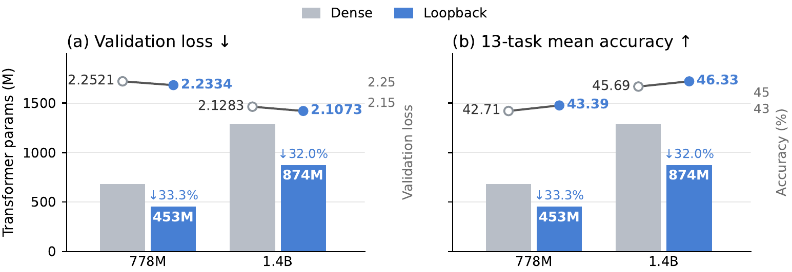
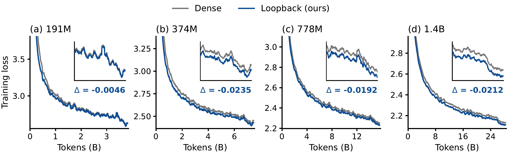

# Loopback Transformer: Towards a Unified View of Residual Looped Transformers

**Authors**: Xuan Ouyang, Zefan Cai, Chenlong Zhang, Cheng Luo, Ke Wan, Junjie Hu

**Affiliations**: University of Wisconsin–Madison, UC Santa Barbara, Caltech, Microsoft

**Paper**: arXiv (link coming) · **Project page and interactive demo**: [yancyou.github.io/Loopback_page](https://yancyou.github.io/Loopback_page/) · **Code**: coming soon

> 📢 We are excited to introduce the **Loopback Transformer**, a looped Transformer that stores the *updates* its shared blocks compute, keeps the loop's input on its own path, and lets a geometric decay set how much of that history is used while attention decides where it goes.
> 
> Looped Transformers apply the same blocks several times, so a 20-block-deep model can be built from 4 shared blocks. But parameter sharing only says *which* computation is reused, not how the results of repeated visits are **stored, carried forward, and read**. We show that this memory rule makes a large difference, and that one depth-memory view (write, carry, read) covers ordinary residual addition, Attention Residuals, Hyper-Connections, Hyperloop and recurrent-depth readers alike.
> 
> Trained on ClimbMix at matched tokens and matched depth, Loopback reaches **lower validation loss and higher zero-shot accuracy than dense Transformers** while using **40%, 58%, 67% and 68%** of their Transformer parameters at **191M, 374M, 778M and 1.4B**, and it is the best of nine residual rules at the two scales where we ran the full comparison.

**Takeaways for looped Transformers**

> 🔥 - **Store updates, not outputs.** A block's full output contains its input, so weighting that output also re-weights the history the input carries. Storing the update $\boldsymbol{\delta}_s=f_k(\boldsymbol h_s)-\boldsymbol h_s$ on its own gives every visit a coefficient of its own.
> - **Keep the input on its own path.** A joint softmax over the input and the stored updates makes them compete for one unit of weight, so the input fades as depth grows; plain addition keeps the input fixed but lets the total update weight grow with every block application. Loopback fixes the input coefficient at 1 and bounds the total.
> - **Decay sets the total, attention allocates it.** A geometric factor $\lambda$ at each visit end gives a recency prior whose total is at most $K\lambda/(1-\lambda)$; a softmax over the stored updates redistributes that total. Decay alone recovers most of the gain over the plain loop (2.6802 → 2.6220 at 191M), and learned allocation adds the rest (2.6187).
> - **Reading updates beats reading states.** Eleven linear-attention and recurrent readers (Gated DeltaNet, Mamba-2, RWKV-7, …) all do better when fed the stored updates than when fed loop states, and all of them stay behind Loopback.
> - **It costs little.** About +0.08% forward FLOPs, a fused Triton kernel that streams the stored updates once per read, and at 1.4B a model whose weights take 1.87 GiB instead of 2.64 GiB in bf16.


*The loop, one application at a time. The hidden state circles the shared blocks (blue and peach); every application appends its update to the history on the right, and the reader forms the next state from the input (fixed coefficient 1) and the stored updates. At each visit end every stored weight is multiplied by λ; attention then reallocates the total. The interactive version with sliders for K, R, λ and the attention query is on the project page.*

---

# 🔁 Why a looped model needs a memory rule

A looped Transformer runs a prefix of ordinary blocks, then visits a shared stack of $K$ blocks $R$ times, then runs a coda. We write such a topology as $[P \to K \times R \to C]$; the 191M model, for instance, is $[2 \to 4 \times 4 \to 2]$: 20 block applications from 8 distinct blocks. Depth is cheap, parameters are shared, and the model can keep refining one hidden state.

Each visit applies the same transformation to a *different* hidden state and therefore produces a different update. That raises the question the paper is about: **how should the updates from repeated visits be stored, carried forward, and used?** Parameter sharing decides which transformation is reused; it says nothing about how the results accumulate.

Residual connections are the natural lens, because they turn depth into memory: every layer *writes* new computation into the residual stream, the stream *carries* it forward, and later layers *read* it. Seen this way, the familiar residual rules differ only in what they write and how they weight what they read:

- **Addition** writes the update and reads everything with coefficient one, so the total update weight grows linearly with depth.
- **Attention Residuals** keep an explicit history of layer outputs and learn to weight them, but through one softmax shared by the input and the history.
- **Hyper-Connections, mHC and Hyperloop** carry several residual streams and learn the pathways between them.
- **Recurrent-depth readers** (Mamba-2, DeltaNet, RWKV-7, …) fold the history into a fixed-size state.


*Figure 1. Three ways to carry depth as memory: (a) residual addition, (b) an explicit history of updates read by a learned reader, (c) multiple memory streams. All three fit one interface: write a value, carry the memory forward, read it to form the next hidden state.*

# ⚖️ Two couplings hidden in the usual choices

Unrolling the interface gives every earlier update an explicit coefficient in the next hidden state, and that exposes two couplings that ordinary choices create without meaning to.

### 1. Storing a full output also stores its input

A block's output is $\boldsymbol y_s=\boldsymbol h_s+\boldsymbol{\delta}_s$: the new update plus the input the block received. If the memory stores $\boldsymbol y_s$ and a reader later assigns it a weight $c$, that weight lands on $\boldsymbol h_s$ too, which already contains the whole history up to step $s$. Earlier information gets re-weighted as a side effect of weighting later outputs. Storing $\boldsymbol{\delta}_s$ alone lets a reader address each visit's contribution directly.

### 2. One softmax couples the input to the updates

With a joint softmax over the input and all stored updates, the coefficients sum to one, so after $s$ applications the input is left with a weight of about $1/(s+2)$ while the updates share the rest. Plain addition has the opposite problem: the input keeps coefficient one, but every update also gets coefficient one, so the total update weight is $s+1$ and keeps growing with depth.

$$
\begin{aligned} \text{addition:}&\quad \boldsymbol h_{s+1}=\boldsymbol h_0+\sum_{i\le s}\boldsymbol{\delta}_i \\[2pt] \text{joint softmax:}&\quad \boldsymbol h_{s+1}=c_{\mathrm{in}}\,\boldsymbol h_0+\sum_{i\le s}c_i\,\boldsymbol{\delta}_i,\qquad c_{\mathrm{in}}+\sum_{i\le s} c_i=1 \end{aligned}
$$

Neither rule gives independent control over three things that matter in a loop: **how strongly the input enters**, **how much total weight the updates get**, and **how that weight is allocated** across visits. Loopback is built to control each one separately.

# 🧭 The Loopback recipe


*Figure 2. Loopback on a two-visit loop. (a) Each shared-block application appends its update δ and reads the history. (b) Visit-end decay sets the prior and the total weight. (c) Attention reallocates that total across the raw updates; the input enters with coefficient one and is never decayed.*

### Step 1. Store the update, keep the input on its own path

Every application of a shared block writes only its update $\boldsymbol{\delta}_s=f_k(\boldsymbol h_s)-\boldsymbol h_s$ into the history. The shared stack's input $\boldsymbol h_0$ never enters that history: it is added back directly, with coefficient one, in every read. The shared blocks themselves are untouched.

### Step 2. Let decay set the prior and the total

At the end of each visit, every stored weight is multiplied by a fixed $\lambda$ (we use $\lambda=1/4$). Counting the visit ends between a write at step $i$ and a read at step $s$ gives a prior $c^0_{s,i}$ and its total $B_s$:

$$
c^0_{s,i}=\lambda^{\lfloor (s+1)/K\rfloor-\lfloor i/K\rfloor},\qquad B_s=\sum_{i=0}^{s}c^0_{s,i}.
$$

The prior favors recent visits, and the total handed to the coda is $B_{KR-1}=K\sum_{j=1}^{R}\lambda^j\le K\lambda/(1-\lambda)$ instead of $KR$: the update weight is bounded no matter how many visits the loop runs. With zero attention queries this is the whole rule, and it already has a closed form: the loop output is $\boldsymbol h_0+\lambda\,(F(\boldsymbol h)-\boldsymbol h_0)$ with $F$ the shared stack, which is why we call the decay-only variant the *anchored* loop.

### Step 3. Let attention allocate the total

A destination query scores the normalized stored updates and redistributes the decay-set total across them; the softmax is over updates only, so the input coefficient stays at one and the total $B_s$ is conserved:

$$
\begin{aligned} \boldsymbol k_i&=\frac{\boldsymbol{\delta}_i}{\sqrt{d^{-1}\|\boldsymbol{\delta}_i\|^2+\varepsilon}},\qquad z_{s,i}=\boldsymbol q_s^{\top}\boldsymbol k_i/\sqrt d, \\[2pt] c_{s,i}&=B_s\,\operatorname{softmax}_i\bigl(z_{s,i}+\log c^0_{s,i}\bigr),\qquad \boldsymbol h_{s+1}=\boldsymbol h_0+\sum_{i=0}^{s}c_{s,i}\,\boldsymbol{\delta}_i . \end{aligned}
$$

Two sanity checks fall out of the formula. Zero queries recover the decay-only loop exactly; $\lambda=1$ with zero queries recovers ordinary addition. Everything Loopback adds is in the read, so a fused Triton kernel that streams the stored updates once per read is all the extra machinery it needs.

---

# 📈 Results

All comparisons share the training-token budget and the computational depth (number of block applications) within a scale; parameter counts are Transformer-only, excluding embeddings and the vocabulary head, with shared weights counted once. Models are trained from scratch on ClimbMix with a WSD schedule at 20 tokens per parameter of the dense control.

### Dense-model quality from a fraction of the parameters



*Figure 3. Transformer parameters with validation loss (left) and 13-task mean accuracy (right) at 778M and 1.4B. Loopback (blue) beats the matched-depth dense control (grey) with 67% and 68% of its Transformer parameters; the 191M and 374M rows of the table below show the same picture at 40% and 58%.*

| Scale | Topology | Transformer params (Dense → Loopback) | ClimbMix loss (Dense → Loopback) | 7-task mean (Dense → Loopback) |
|---|---|---|---|---|
| 191M | [2 → 4 × 4 → 2] | 141.6M → 56.7M (40%) | 2.6234 → **2.6187** | 39.81 → **40.16** |
| 374M | [2 → 10 × 2 → 2] | 308.3M → 179.9M (58%) | 2.4198 → **2.3971** | 43.28 → **44.27** |
| 778M | [2 → 8 × 2 → 6] | 679.6M → 453.1M (67%) | 2.2521 → **2.2334** | 47.83 → **48.73** |
| 1.4B | [3 → 8 × 2 → 6] | 1,284.6M → 873.6M (68%) | 2.1283 → **2.1073** | 52.11 → **52.98** |

The seven tasks are PIQA, HellaSwag, WinoGrande, OpenBookQA, ARC-Easy, ARC-Challenge and LAMBADA (zero-shot, lm-evaluation-harness). On the thirteen-task suite the 778M and 1.4B models also lead, 43.39 vs 42.71 and 46.33 vs 45.69, and their WikiText perplexity is lower (25.03 vs 25.80; 20.29 vs 21.09).



*Figure 4. Training loss of Loopback and the dense control at each scale, with the final gap in the inset. The curves cross early and the gap is stable over the decay phase.*

### Against eight other residual rules

At 191M and 374M we trained every rule on the same looped topology, with the same data order and the same learning rate for all looped arms (dense controls use their own best rate). Validation loss and the seven-task mean:

| Rule | 191M loss | 191M mean | 374M loss | 374M mean |
|---|---|---|---|---|
| Dense (full parameters) | 2.6234 | 39.81 | 2.4198 | 43.28 |
| Plain loop (addition) | 2.6802 | 39.03 | 2.4415 | 43.37 |
| mHC | 2.6250 | 39.83 | 2.4062 | 44.17 |
| HC | 2.6449 | 39.20 | 2.4249 | 43.72 |
| iHC | 2.6564 | 39.67 | 2.4217 | 43.35 |
| Hyperloop | 2.6489 | 39.12 | 2.4179 | 44.07 |
| MHAR | 2.6564 | 39.04 | 2.4223 | 43.64 |
| Attention Residuals | 2.6647 | 39.73 | 2.4601 | 42.89 |
| **Loopback** | **2.6187** | **40.16** | **2.3971** | **44.27** |

The plain loop pays 0.057 and 0.022 of loss for sharing its blocks. Loopback gives all of that back and then some; the strongest alternative, mHC, lands 0.006 and 0.009 behind it in loss. The full thirteen-task tables, the per-task numbers and the learning-rate protocol are in the paper.

---

# 🔬 What makes it work

### Decay does most of the work, attention finishes it

Switching the two mechanisms on and off separately gives a clean 2 × 2. Fixed allocation means zero queries; decay off means $\lambda=1$.

| Decay \ Allocation | Fixed (191M) | Learned (191M) | Fixed (374M) | Learned (374M) |
|---|---|---|---|---|
| Off (λ = 1) | 2.6802 | 2.6621 | 2.4415 | 2.4308 |
| On (λ = 1/4) | 2.6220 | **2.6187** | 2.3999 | **2.3971** |

Decay alone moves the plain loop from 2.6802 to 2.6220 at 191M and from 2.4415 to 2.3999 at 374M, past the dense control in both cases; learned allocation adds a further 0.003. Attention without decay helps too, but much less: a bounded total matters more than a learned split of an unbounded one.

### Robust to initialization

Loopback keeps its lead under three initializations at 191M, while the dense model's loss swings by 0.09: $\mathcal N(0,0.02^2)$ 2.6187 vs 2.6234, GPT-2 scaling 2.6178 vs 2.6419, PyTorch default 2.6138 vs 2.7145.

### Feed readers updates, not states

The unified interface also lets us swap the reader. We replaced Loopback's attention read with eleven linear-attention and recurrent readers and fed each one either the stored updates or the loop states. Updates win in every family at both scales, and the best reader (Gated DeltaNet at 191M, HGRN-2 at 374M) still trails Loopback by 0.03 of loss.


*Figure 5. Validation loss of eleven memory readers fed updates (solid) or states (hatched) at 191M and 374M; the dashed lines mark the plain loop, Dense and Loopback.*

---

# ⚙️ What it costs

The read is the only addition, so the FLOP overhead is tiny (+0.08% at 191M and 374M, +0.04% at 778M). The fused kernel keeps the throughput cost moderate: at 778M Loopback trains at 63k tokens per second per GPU against 76k for the plain loop and 75k for the dense model, and prefills at 217k tokens per second against 269k. The parameter saving shows up where it is persistent: at 1.4B the weights take 1.87 GiB instead of 2.64 GiB in bf16, and weights plus a 4k-token KV cache take 2.65 GiB instead of 3.42 GiB.

| Model (778M setting) | Transformer params | Extra FLOPs | Train tok/s/GPU | Prefill tok/s |
|---|---|---|---|---|
| Dense | 679.6M | – | 75k | 269k |
| Plain loop | 453.0M | +0.00% | 76k | 269k |
| mHC | 453.3M | +0.04% | 68k | 240k |
| **Loopback** | 453.1M | +0.04% | 63k | 217k |

---

# 🧪 Try it

The project page has an interactive version of the animation above: play the loop step by step, change $K$, $R$ and $\lambda$, point the attention query at a visit, and watch the input coefficient, the total update weight and the allocation respond. The same page collects the figures and the BibTeX.

https://yancyou.github.io/Loopback_page/

Training and evaluation code is being prepared for release; the paper has every setting needed to reproduce the tables, including the WSD schedule, the data order and the learning-rate protocol for looped arms.

# 📖 Citation

```latex
@article{ouyang2026loopback,
  title   = {Loopback Transformer: Towards a Unified View of Residual Looped Transformers},
  author  = {Ouyang, Xuan and Cai, Zefan and Zhang, Chenlong and Luo, Cheng and Wan, Ke and Hu, Junjie},
  journal = {arXiv preprint},
  year    = {2026}
}
```
